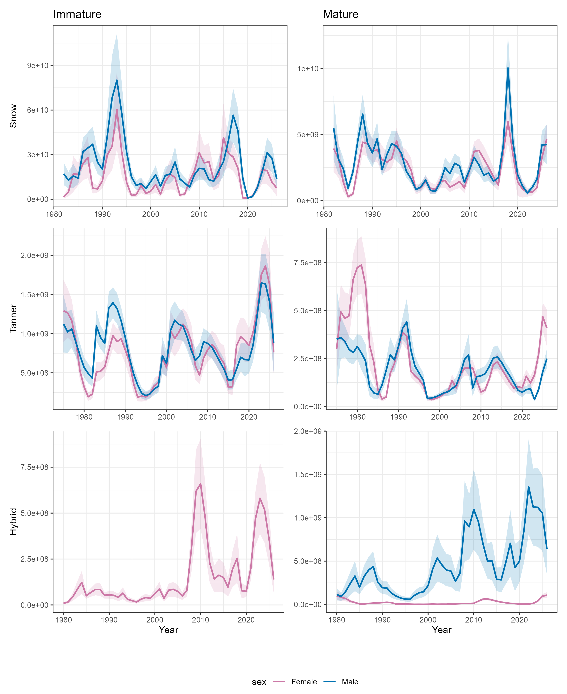
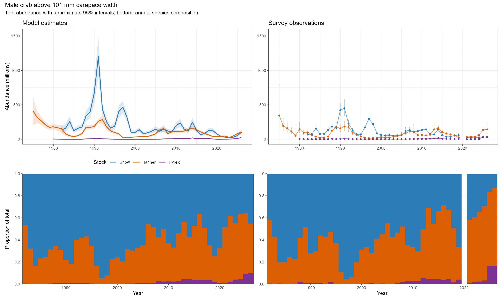
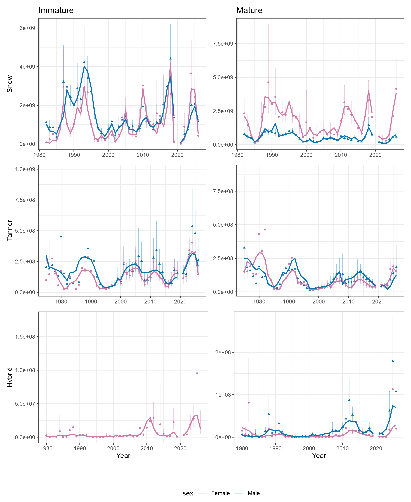
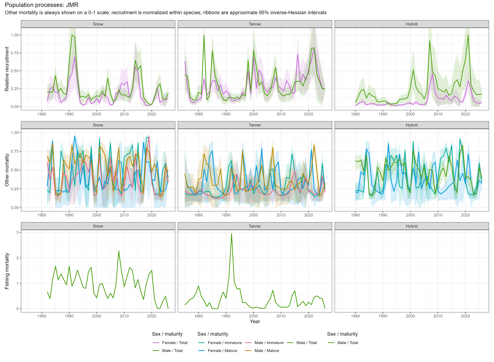
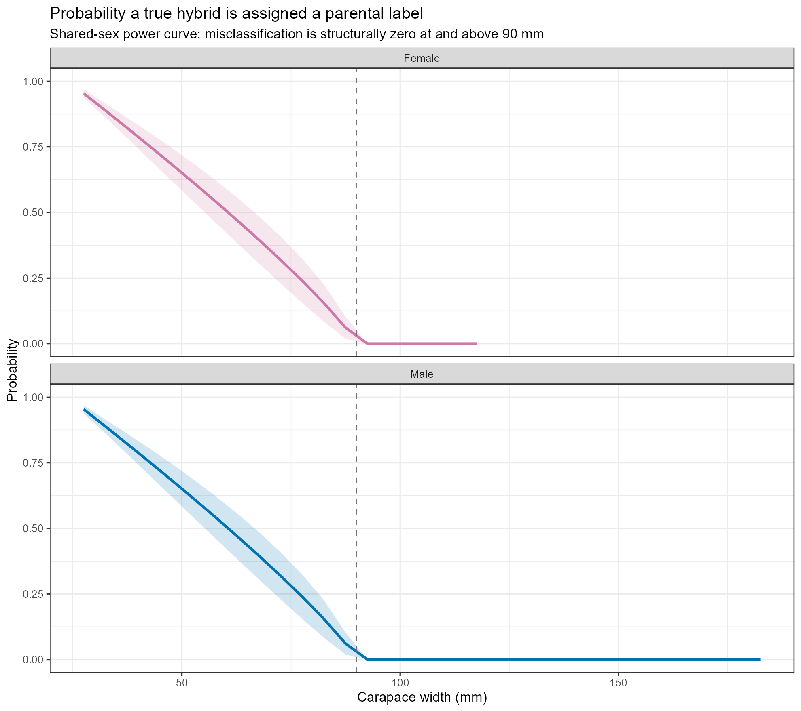

```{r setup, include=FALSE}
options(tinytex.install_packages = FALSE)
knitr::opts_chunk$set(echo = FALSE, message = FALSE, warning = FALSE)
```

\newpage

**Authors:** [Names]

**Affiliations:** [Affiliations]

**Corresponding author:** [Name and email]

## Abstract

[Background, objectives, approach, principal results, and implications.]

**Keywords:** [Keywords]

## Introduction

[Introduce marine heatwaves, population change, and opportunities for hybridization.]

[Describe the snow–Tanner crab system, the relevant reproductive biology, and the Bering Sea context.]

[State the knowledge gap, hypotheses, and study objectives.]

## Methods

We used a joint population dynamics model to describe changes in the abundance and size composition of snow crab, Tanner crab, and their hybrids in the eastern Bering Sea. The model followed male and female crab as they survived, grew, entered the modeled population, and matured, with fishing removals included for parental males. Survey and fishery observations informed these processes, while growth observations and maturation probabilities supplied information on changes in size and maturity. The observation model linked biological populations to recorded species labels by allowing some hybrids to be identified as parental crab. This distinction allowed population change and classification error to be estimated within the same framework.

### Study area and input data

The analysis combined bottom-trawl survey abundance indices and size compositions with retained and discarded or total fishery catches, individual growth observations, and annual maturation probabilities at size. Data were organized by species group, sex, year, and maturity state. Survey observations for hybrid males combined immature and mature animals. No survey was conducted in 2020, and that year contributed no survey abundance observation.

[Describe survey coverage and sampling, species identification, sex and maturity assignments, and fishery data collection; add source citations and a table of component-specific years, size ranges, and sample sizes.]

All six population components began at a carapace-width midpoint of 27.5 mm and used 5 mm size classes, with different upper size limits. The smallest snow-male class was added using survey abundance for 25–29 mm animals calculated from the cached station-level data. These animals were assigned to the immature category, consistent with the zero mature proportion supplied for the smallest class in the available maturity input. That proportion was also used in years without maturity input. The annual immature abundance index was increased by the added class, while the original annual coefficients of variation were retained as an approximation for the expanded index. Details of this extension and its assumptions are given in the Supplementary material.

### Joint population dynamics model

<!-- Draft scope retained from the previous version: the common annual mortality driver and the internally fitted parental-abundance effect on hybrid recruitment are omitted. Hybrid recruitment appears only as an entry flux needed for population accounting. The current saved JMR fit includes the parental-recruitment effect; its figures and diagnostics do not represent a refitted model without that effect. This stylistic revision does not change the model or fitted objects. See METHODS_STYLE_NOTES.md for the unresolved manuscript/fit discrepancy. -->

#### Population structure and annual cycle

The model tracked numbers of crab in six species-group-by-sex components, each with immature and mature states. Let $N^I_{g,t,z}$ and $N^M_{g,t,z}$ denote abundance for component $g$, year $t$, and size class $z$. Immature crab could grow and undergo terminal molt; mature crab survived without further growth. Hybrid males were tracked in both states even though their survey data represented total abundance. Initial abundance at size was estimated separately for each component and maturity state, except that the initial hybrid-male abundance vector was divided between states using terminal-molt probability.

Within each annual interval, parental males first experienced natural mortality, followed by a pulse fishery. Surviving immature crab then grew, recruits entered the smallest size classes, and terminal molt transferred animals to the mature state. The remaining natural mortality acted before the next annual census. Females and hybrid males had no explicit fishing removals: natural mortality acted over the annual interval, followed by growth, recruitment, and maturation. These transitions are described below in the order in which they entered the population accounting.

The six components were estimated jointly. Hybrid growth, mortality, male terminal molt, and survey selectivity were constrained by the corresponding parental estimates or input curves. Classification error provided an additional link by determining how vulnerable hybrid abundance contributed to the observed parental categories. Thus, information from one component could affect estimates for the others through specified biological constraints and the observation model.

#### Survival and fishing removals

For parental males, natural mortality acted for 0.59 of the annual interval before fishing. Numbers entering the fishery were

$$
B^k_{g,t,z}=N^k_{g,t,z}\exp(-0.59M^k_{g,t}),\qquad k\in\{I,M\},
$$

where $M^k_{g,t}$ is the annual instantaneous natural-mortality rate. The number captured depended on fully selected fishing mortality $F_{g,t}$ and capture selectivity $s^{\mathrm{fish}}_{g,t,z}$:

$$
C^k_{g,t,z}=B^k_{g,t,z}\left[1-\exp\left(-F_{g,t}s^{\mathrm{fish}}_{g,t,z}\right)\right].
$$

A retention probability $h_{g,t,z}$ divided captured crab into retained and discarded catches. If $v_g$ is the supplied discard-survival fraction, numbers remaining after fishing were

$$
U^k_{g,t,z}=B^k_{g,t,z}-C^k_{g,t,z}
+v_g C^k_{g,t,z}(1-h_{g,t,z}).
$$

Retained catch was $h_{g,t,z}\sum_k C^k_{g,t,z}$. The model fitted retained and discarded catch for snow crab and retained and total catch for Tanner crab, together with their size compositions. Capture selectivity and retention were separate increasing logistic functions of size, each with an estimated mean intercept, positive slope, and annual deviations in intercept and log slope. Fully selected fishing mortality also varied annually and was zero when the fishery was inactive.

For females and hybrid males, numbers available for subsequent transitions were $U^k_{g,t,z}=N^k_{g,t,z}\exp(-M^k_{g,t})$. Hybrid males used a single natural-mortality rate for both maturity states. The parameterization of parental rates and constraints on hybrid rates are described after the annual transitions.

#### Growth, recruitment, and maturation

Growth moved surviving immature crab among size classes. For parental species and each sex, postmolt width was related to premolt width by

$$
z_{\mathrm{post}}\sim\mathcal{N}(\alpha_g+\beta_g z_{\mathrm{pre}},\sigma_g^2).
$$

The regression parameters were estimated jointly with the population dynamics using individual growth observations. Integrating this distribution over destination classes gave a size-transition matrix $G_g$, with columns representing source classes. Probability below the upper boundary of the source class remained in that class, preventing shrinkage; the largest class was an absorbing plus group. Hybrid mean postmolt width and residual standard deviation were constrained to weighted averages of the parental values, with separate estimated weights for mean growth and variability for each sex.

Recruitment represented entry into the modeled size range. Annual parental recruitment was estimated as a component-specific mean modified by centered log-scale deviations. Two estimated logits allocated recruits among the first three classes, at 27.5, 32.5, and 37.5 mm, with positive proportions summing to one. Writing the recruitment-at-size vector as $\mathbf{r}_{g,t}$, immature abundance after growth and recruitment was

$$
\mathbf{A}_{g,t}=G_g\mathbf{U}^I_{g,t}+\mathbf{r}_{g,t}.
$$

The recruitment vector also supplied the entry flux for hybrids. Its relationship to parental abundance is outside the specification described here. <!-- This omission remains substantive: reconcile with the fitted recruitment relationship before presenting the current JMR results as a complete analysis. -->

Maturation probability at size, $\mathbf{p}_{g,t}$, then divided this abundance between animals remaining immature and animals undergoing terminal molt. Parental-male probabilities were supplied as annual observed probabilities at size. Hybrid-male probabilities were a time-invariant weighted average of the parental median curves. For females, the inputs were annual proportions mature among new-shell animals at size. Parental curves were interpolated to hybrid sizes with constant endpoint extrapolation where necessary.

The transition to the next year was

$$
\mathbf{N}^I_{g,t+1}=\left[\mathbf{A}_{g,t}\odot(1-\mathbf{p}_{g,t})\right]
\exp(-\Delta_g M^I_{g,t}),
$$

$$
\mathbf{N}^M_{g,t+1}=\left[\mathbf{U}^M_{g,t}+\mathbf{A}_{g,t}\odot\mathbf{p}_{g,t}\right]
\exp(-\Delta_g M^M_{g,t}),
$$

where $\odot$ denotes elementwise multiplication. For parental males, $\Delta_g=0.41$ applied the remaining natural mortality after terminal molt, using the receiving maturity state's rate. For females and hybrid males, $\Delta_g=0$ because the full year's mortality had already been applied. These equations complete the annual cycle for all six components while retaining their different treatment of fishing and mortality timing.

#### Annual natural mortality

Parental natural mortality varied by species, sex, maturity state, and year:

$$
M^k_{g,t}=0.10+\exp(\mu^k_g+d^k_{g,t}).
$$

Here, $\mu^k_g$ is baseline log mortality above the 0.10 floor and $d^k_{g,t}$ is an annual deviation. Deviations varied independently among years under Gaussian regularization. Because the 2020 survey was missing, deviations for that year were fixed to zero, so parental mortality equaled its component-specific baseline. This constrained the allocation of population change across the interval between the 2019 and 2021 surveys.

Hybrid mortality was an estimated weighted average of parental rates, with weights restricted to the interval zero to one. Female hybrids used the corresponding immature- and mature-female rates. Hybrid males used one rate for both states, with each parental endpoint defined as the mean of that species' immature- and mature-male rates. The weights had estimated baseline logits and regularized annual deviations. Hybrid mortality could therefore vary annually while remaining within these parental bounds.

### Linking populations to survey observations

The population transitions described biological abundance. Survey predictions additionally accounted for size-dependent vulnerability and the possibility that a hybrid was recorded under a parental label. Vulnerable abundance was the product of population abundance and survey selectivity at size. Parental selectivity was modeled as

$$
\operatorname{logit}(s_{g,e,z})=\operatorname{logit}(s^0_{g,z})
+a_{g,e}+b_{g,e}\frac{z-\overline{z}_g}{30},
$$

where $s^0_{g,z}$ is a reference curve and $e$ distinguishes the pre-1988 and 1988-onward survey eras. Male reference curves and probability-scale priors came from net-efficiency study inputs. Female reference curves came from standalone models. Hybrid selectivity was constrained between the corresponding interpolated parental curves using an estimated weight for each sex.

The probability that a true hybrid was recorded as a parental species declined with size:

$$
q(z)=\operatorname{logit}^{-1}\left[a_c-\exp(b_c)\frac{z-60}{30}\right].
$$

The same estimated curve applied to both sexes. At each year and size, $q(z)$ of vulnerable hybrid abundance was removed from the predicted hybrid category and added to parental categories in proportion to their vulnerable abundance. Male allocation used both species and maturity states together; female allocation was proportional within each maturity state. Consequently, male parental categories had equal reallocated fractions at a shared size and year when both populations were represented, whereas female fractions combined across maturity states could differ with maturity composition. The reverse classification error, in which parental animals were recorded as hybrids, was not included. The resulting predictions corresponded to recorded labels after classification error.

### Objective function

Parameters were estimated by minimizing a joint objective that combined survey and fishery fits, growth-observation likelihoods, and regularization terms. Survey abundance indices and catch totals contributed lognormal discrepancy terms. For observed abundance $O$, prediction $\widehat{O}$, and supplied coefficient of variation $CV$, the contribution, omitting parameter-independent constants, was

$$
\ell_A=\frac{[\log(\widehat{O})-\log(O)]^2}{2\log(1+CV^2)}.
$$

Only valid positive observations with positive CVs were used. Survey CVs before 1988 were multiplied by 1.25 to reduce the influence of indices collected before the survey footprint stabilized. Later CVs were retained, apart from correction of the 2021 snow-male input values described in the Supplementary material. The CV approximation associated with extending the snow-male size range is described above.

Survey and fishery size compositions contributed weighted multinomial-style terms,

$$
\ell_C=-w\sum_z o_z\log(\widehat{p}_z),
$$

where $o_z$ and $\widehat{p}_z$ are observed and predicted size proportions, and $w$ is the composition weight. Survey predictions included selectivity and classification error before either abundance or size-composition contributions were evaluated. Gaussian likelihoods for the individual growth observations supplied information on the growth regressions. [Provide the annual composition weights and their derivation in the supplementary data table.]

### Regularization and estimation

Regularization allowed annual variation while limiting extreme estimates in years or size classes with little information. Parental mortality deviations received independent Gaussian penalties rather than temporal smoothing. Baseline priors corresponded to annual natural mortality of 0.30. Annual recruitment deviations, fishing mortality deviations, and fishery-selectivity deviations were also regularized. Second-difference penalties on initial log abundance discouraged isolated size-specific spikes, while weak priors on its mean and mean slope were centered on standalone-model starting distributions. Survey-selectivity and classification priors supplied additional information on the observation process. The numerical priors and bounded-deviation transformations are specified in the Supplementary material.

The model was implemented in R 4.4.2 using RTMB 1.7 and automatic differentiation. Population parameters and annual deviations were estimated jointly as a penalized mode, or maximum a posteriori estimate. Annual deviations were optimized directly rather than integrated out with a Laplace approximation. Optimization used `nlminb` with repeated refinement. Numerical checks included the maximum absolute gradient and positive definiteness of the objective Hessian; inverse-Hessian uncertainty was propagated to derived quantities using the delta method. [Report diagnostics from the final manuscript-specific fit. Distinguish completed checks from any planned alternative-optimizer, perturbed-start, or retrospective analyses.]

### Environmental and population-process analyses

[Describe marine heatwave metrics, environmental datasets, population-process analyses, covariate selection, and treatment of temporal dependence.]

### Hybridization analysis

[Describe the analysis relating hybrid dynamics to parental population abundance and composition, including lag selection, candidate models, uncertainty propagation, and diagnostics. Reconcile this section with any parental effect estimated inside the population model.]

### Sensitivity analyses

[Describe completed sensitivity analyses for mortality, selectivity priors, classification error, survey weighting, and the lower size boundary. Identify the implications of retaining the original survey CVs and extrapolating snow-male selectivity at 27.5 mm.]


## Results

### Joint model fit and population trajectories

[Report fit diagnostics, estimated abundance, and uncertainty.]

### Population responses to marine heatwaves

[Report changes in mortality, recruitment, maturation, and parental population composition.]

### Hybridization and parental population change

[Report hybrid dynamics and relationships with parental populations.]

### Sensitivity analyses

[Summarize robustness and important limitations.]

## Discussion

[Summarize the principal findings in relation to the hypotheses.]

[Discuss mechanisms linking marine heatwaves, parental population changes, and hybridization; distinguish demonstrated relationships from proposed mechanisms.]

[Discuss classification uncertainty, model assumptions, and other limitations.]

[Discuss implications for crab population dynamics, fisheries, and climate-driven ecological change.]

## Conclusions

[Concise conclusions supported by the results.]

## Acknowledgments

[Acknowledgments and funding.]

## Author contributions

[Contributions using the target journal's preferred format.]

## Data and code availability

[Data access conditions, repository links, archived release, and reproducibility instructions.]

## Competing interests

[Declaration.]

## References

[Add references for survey and catch data, growth and net-efficiency studies, assessment inputs, RTMB, and the ecological literature.]

## Tables and figure captions

[Table 1. Data sources, modeled years and size ranges, and observation sample sizes.]

[Table 2. Model parameters, constraints, and prior distributions.]

[Selected figures and captions follow the supplementary-material placeholder.]

## Supplementary material

[Detailed parameterization, composition weights, data processing, model diagnostics, and sensitivity results.]

### Supplementary methods: parameterization and input details

Parental recruitment deviations were centered and transformed as $5\tanh(\widetilde{\epsilon}_{g,t}/5)$, with independent Gaussian penalties of standard deviation 0.60 on the underlying deviation parameters. Two recruitment-allocation logits, with the third class as reference, had Gaussian priors centered at $\log(0.75/0.05)$ and $\log(0.20/0.05)$, each with standard deviation 1.5. These priors favored recruitment proportions of 0.75, 0.20, and 0.05 in the first three size classes.

Parental mortality deviations were centered over eligible years and transformed as $d=4\tanh(\widetilde{u}/4)$. The underlying annual parameters had independent zero-mean Gaussian penalties with standard deviation 0.50. Baseline log mortality above the 0.10 floor had prior mean $\log(0.20)$, with standard deviation 0.10 for immature parental components and 0.20 for mature parental components. Annual deviations in fishing mortality and in the intercepts and log slopes of the fishery-selectivity curves had Gaussian penalties with standard deviation 0.50.

Female survey-selectivity shift and tilt parameters had zero-mean Gaussian priors with standard deviation 0.35. Classification parameters had priors $a_c\sim\mathcal{N}(-2,1.5^2)$ and $b_c\sim\mathcal{N}(0,1)$. [Complete the parameter table with the male probability-scale selectivity priors, hybrid blend-weight priors, initial-state penalties, and all remaining numerical settings.]

The 2021 immature- and mature-snow-male survey CVs were corrected to 0.131392 and 0.131379, respectively, using the assessment inputs. For the added 27.5 mm snow-male class, the survey-selectivity prior was extrapolated linearly on the logit scale from the original 32.5 and 37.5 mm classes. Original selectivity-prior values and their size-specific standard deviations were preserved. The new class received zero mature abundance and terminal-molt probability, and a zero entry in fishery catch compositions; growth transitions were rebuilt on the expanded grid. Original annual survey CVs and composition weights were retained. These choices should be evaluated in the lower-size-boundary sensitivity analysis before finalizing the manuscript.

\clearpage

## Figures

**Draft provenance note.** These figures are existing outputs from the current JMR fit, not a new fit to the manuscript-specific model specification. That fit retains the internally estimated parental effect on hybrid recruitment omitted from the draft Methods. The figures must be reconciled with the final analysis before submission. No shared-mortality-driver or internally fitted recruitment-relationship figures are included. These population summaries alone do not establish marine heatwave causation.

\begin{landscape}
\nolinenumbers

```{r fig-populations, echo=FALSE, out.width='8.5in', fig.align='center', fig.cap='Estimated population trajectories for snow, Tanner, and hybrid crab. Columns identify species groups; rows identify immature and mature states. Pink and blue lines denote females and males, respectively, and ribbons show approximate 95% inverse-Hessian intervals. Vertical axes show numbers of crab and differ among panels. Hybrid-male total abundance is displayed in the mature row for plotting convenience; it is not a mature-only estimate.'}

```

\clearpage

```{r fig-large-males, echo=FALSE, out.width='8.5in', fig.align='center', fig.cap='Abundance and species composition of males above 101 mm carapace width. Left panels show latent model estimates and right panels show survey observations. Upper panels show abundance in millions with approximate 95% intervals; lower panels show each species group as a proportion of the annual total. Model and survey abundances are on different observation scales. The survey gap in 2020 reflects the missing survey, not zero abundance. This size-defined group is not a direct measure of mating success.'}

```

\clearpage

```{r fig-survey-fits, echo=FALSE, out.width='8.5in', fig.align='center', fig.cap='Joint-model fits to survey abundance indices. Points are observed indices, vertical bars are lognormal 95% intervals calculated from supplied coefficients of variation, and lines are predictions after survey selectivity and hybrid classification error. Colors distinguish females and males. Axes show numbers of crab and vary among panels. Hybrid-male observations and predictions combine maturity states and are displayed in the mature row; the immature-hybrid panel contains females only.'}

```

\end{landscape}
\clearpage

```{r fig-mortality, echo=FALSE, out.width='6.5in', fig.align='center', fig.cap='Estimated population-process trajectories by species group, sex, and maturity state. Natural mortality is shown as annual probability, calculated as one minus exp(-M), on a zero-to-one scale. Recruitment is normalized within species, and ribbons show approximate 95% inverse-Hessian intervals.'}

```

\clearpage

```{r fig-classification, echo=FALSE, out.width='6.5in', fig.align='center', fig.cap='Estimated probability that a true hybrid is recorded under a parental label as a function of carapace width. The same fitted classification curve is applied to both sexes and displayed over their respective size ranges. Ribbons show approximate 95% inverse-Hessian intervals. The curves describe classification error conditional on the fitted model, not the probability that an animal is biologically hybrid.'}

```

\linenumbers
